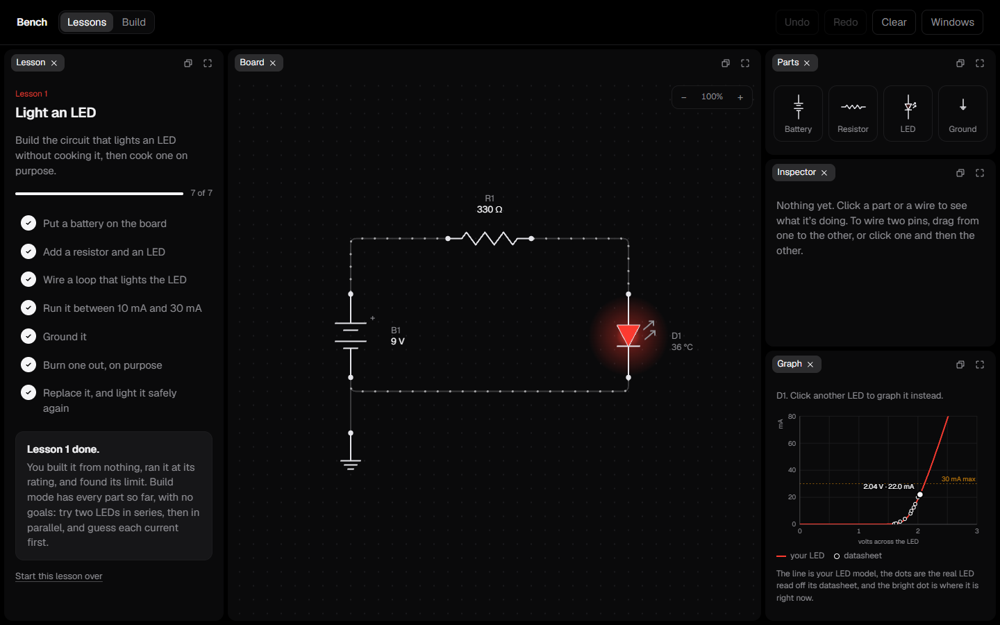
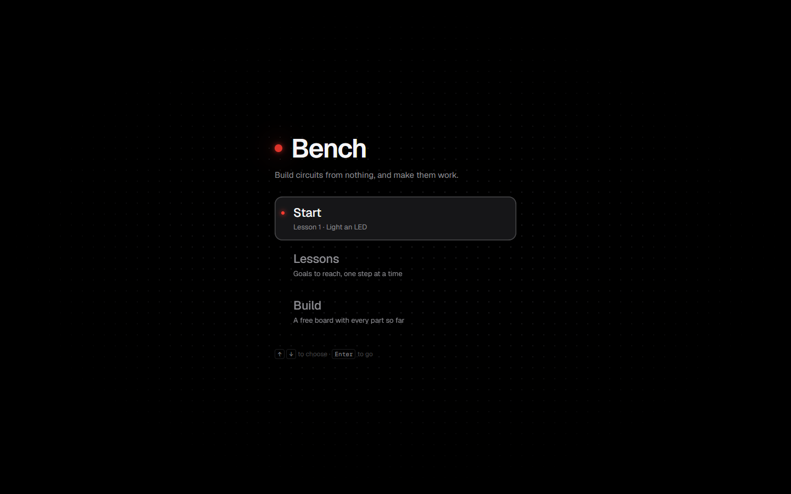

# Bench

A circuit and robotics bench you build as you learn. Every lesson starts from an empty board: you place the
parts, wire them and make them work. Each lesson adds the engine features it needs, and you write the part
models yourself: the engine, screen and tests tell you when they're right.



## Run it

```sh
pnpm install
pnpm dev          # http://localhost:5180
pnpm test:watch   # engine tests, re-run on save
pnpm check        # types, lint and every test
```

The first time, open **Settings** and choose your home folder: where your own work is kept, outside this repo
(see [Your home folder](#your-home-folder)).

## The menu



Bench opens on a main menu: **Continue** (or Start) picks up the lesson you're on, **Lessons** lists them all
with your progress (and the ones still to come, locked), **Build** lists your projects, and **Settings** says
where your work is kept. Arrow keys and Enter
work as in a game; Esc on the lesson list goes back. In the workspace, the trail at the top left
(Bench / Lessons / Light an LED) goes back up.

- **Lessons**: a goal and a list of steps, checked against the live circuit as you build. A step passes because
  the physics says so (the LED really carries 10–30 mA), not because parts sit in the right places. Progress
  and the board are saved per lesson; *Start this lesson over* clears both.
- **Build**: your projects, like a game's save slots. Each is a board with every part so far and no goals, kept as
  a folder of its own (see [Your home folder](#your-home-folder)): start a new one, or rename, duplicate or delete
  one. Click a project's name in the header to rename it.

Each lesson and each project has its own board and undo history; Lessons and Build each keep their own arrangement
of windows. Where you are lives in the address (`#/build/night-light`, `#/lessons/light-an-led`), so a reload comes
back to the same place.

## The workspace

Everything is a window: **Board**, **Parts**, **Meter**, **Inspector**, **Graph** and **Serial Monitor** (tabs
beside the Inspector), **Code** (below the Board, when you open it), and in Lessons, **Lesson**.

- Drag a tab to move a window: into another window's tab bar, or to any edge to split. Drag the gaps between
  windows to resize them.
- The two buttons at the right of each tab bar float the window over the others (or dock it back where it
  belongs), and maximise it.
- **Windows** in the header opens and closes windows, and *Reset layout* puts everything back. The arrangement
  is saved as you change it.
- Below 900 px wide (phones), the windows stack in one scrolling column instead.

Pop-out windows (a window in its own browser window, for a second screen) are not on yet.

## On the board

- Drag a part from **Parts** onto the board, or click it to drop one in the middle of the view.
- Drag from one pin to another to wire them, or click one pin and then the other. Hollow pins have nothing
  attached: parts connect only through wires, never by touching.
- **Tap into a wire anywhere**: drop a wire end on the middle of another wire, or press on a wire and drag a new
  one out of it. A dot (a junction) appears where they join. Delete the tap, or the dot, and the wire heals back
  into one.
- Click a part or a wire for what it's doing right now, and to change its value.
- **On a phone or tablet**: one finger on empty board pans, two fingers pinch to zoom (and pan), a finger on a
  part moves it, and a finger from pin to pin draws a wire. Tap a part tile to add it in the middle of the view.
  A second finger landing while the first moves a part turns it into a pinch instead. The page scrolls from
  anywhere but the board.
- **Switches and buttons**: click a slide switch's lever to slide it to its other side (saved, and undoable). Press
  and hold a push button's cap to hold it down; it springs back up when you let go. Two fingers hold two buttons
  on a touchscreen; with a mouse, right-click a button and choose *Hold down* (or use the Inspector) to keep one
  down while you press another.
- **Knobs**: drag a knob's dial up or right to turn it towards pin 3, down or left towards pin 1 (one drag is one
  undo step), or use the slider in the Inspector. The wiper's arrow slides along the track as it turns, and the
  Inspector shows both legs: their resistance, the volts across each, and the current out of the wiper.
- **Select several**: Shift- or Ctrl-click to add or remove, or drag a box on empty board. Drag any selected
  part to move them all. <kbd>Ctrl</kbd> <kbd>A</kbd> selects everything; a click on empty board clears.
- **Right-click** a part, a wire or the selection for what you can do with it: rotate, duplicate, copy, replace a
  burnt part, delete. Right-click empty board to add a part right there, paste, select all, or fit the view.
- <kbd>R</kbd> rotates, <kbd>⌫</kbd> deletes, the arrow keys nudge, <kbd>Ctrl</kbd> <kbd>D</kbd> duplicates,
  <kbd>Ctrl</kbd> <kbd>C</kbd> / <kbd>V</kbd> copy and paste (a copy keeps the wires between its parts), all on
  the whole selection. <kbd>Ctrl</kbd> <kbd>Z</kbd> undoes, <kbd>Ctrl</kbd> <kbd>Shift</kbd> <kbd>Z</kbd> redoes;
  each of these is one undo step.
- **Move the view** with a right-drag, Space+drag or the middle button. The wheel zooms around the pointer. 100%
  is actual size; the zoom button frames the parts. Resizing the window keeps the scale and just shows more or
  less. (To make a plain drag on empty board pan instead of selecting, set `EMPTY_DRAG` in `BoardCanvas.tsx`.)
- Add a ground to read pin voltages (hover a pin). Without one the circuit floats: every current is still right,
  but a voltage only means something measured from somewhere.
- **Graph** plots the selected LED or capacitor (with neither selected, the first capacitor, else the first LED).
  For an LED: your model's curve, the datasheet's points, and where it is right now. For a capacitor: its voltage
  over time.
- **Spec sheet** (a tab beside the Meter, or *Spec sheet* in the Inspector) shows the selected part's datasheet:
  maker and part number, the document the numbers come from, and every number Bench simulates it with, each
  labelled with where it comes from (datasheet, standard, fitted to a datasheet graph, worked out, typical for the
  type, or an estimate). Read-only: the numbers are the real parts', read from the engine's own constants.
- **3D view** (a tab beside the Board, or *See it in 3D* in the Inspector) shows the selected knob, capacitor,
  transistor or ESP32 as the real part, to scale, linked to the one on the board; with none selected, one to look at (pick
  which, and the capacitor's size). Drag anywhere to look round it, scroll or pinch to zoom. *Take it apart* lifts every piece
  clear; click a piece, or pick it from the list, to see what it does and where its shape comes from, and hide it to
  see behind it.
  - The knob: drag its shaft (or use the Turn slider, or the arrow keys) to turn it: the same turn and the same undo
    as on the board. Its carbon track is tinted in its two pieces, pin 1 to the wiper and the wiper to pin 3, with
    their resistances from `legs()`.
  - The capacitor: *Unroll the foil* pulls the anode foil, the paper and the cathode foil out of the roll, drawn
    thicker than they are and labelled so. Linked to the board, it shows the volts it's holding and the charge on its
    plates.
  - The transistor: *Take it apart* lifts the body off the lead frame, the chip and its two bond wires. *Show the
    chip's layers* sketches them beside it, magnified: collector (N) at the bottom, the thin base (P), the emitter (N)
    on top. Linked to the board, it shows the current into the base, what that lets through, and whether it's off,
    amplifying or fully on.
  - The ESP32-DevKitC: all 38 pins, named as on the real board's silkscreen, the module with its antenna past the
    board's end, the USB socket, bridge, regulator and buttons. *Take it apart* lifts the module off the board and its
    shield can off the module, showing the ESP32 chip and its flash. Linked to the board, each pin your program uses is
    labelled with what it's doing ("GPIO2 · driving HIGH"), live.
  - How every model is made (units, origin, materials, rendering, handling, physics) is in [docs/3d.md](docs/3d.md).
- **Capacitors**: pick 220 to 2200 µF in the Inspector, which shows what it's holding, the current filling or
  emptying it, and the energy stored. The **Graph** draws the selected capacitor's voltage over the last 30 s, with
  the battery's voltage and the 63 % it reaches in resistance × capacitance seconds.
- **Transistors**: the Inspector shows the current into the base and through the collector, collector ÷ base, and
  whether it's off, amplifying, or switched fully on (when the rest of the circuit, not the base, is setting the
  current: under 90 % of gain × base current, a line Bench draws). The **Graph** draws two things from your model,
  measured with the collector held at 10 V as the datasheet measures gain: collector current against the voltage on
  the base (a diode's climb), and against the current into it (a straight line, 255.9 times steeper). A dot shows
  where it is now, with a trail of where it's been: turn the knob and it rides the line, then goes flat when it's
  fully on.
- **The ESP32** (an ESP32-DevKitC, a handful of its pins: 3V3, GND, GPIO 2, 4, 5, 18, 19, 21, 32, 33 and 34) runs
  its own program (the *Program* tab in the Code window), as soon as the pins' code is written. Each ESP32 on a board
  runs a program of its own, in a worker of its own. What one prints goes to the **Serial Monitor** (the selected
  ESP32's, or the first's),
  with a warning whenever it read a pin that could have gone either way. The Inspector shows each pin's mode, what it
  reads (HIGH, LOW or "?"), its voltage and current; an unconnected pin says so rather than show a voltage that means
  nothing. The **Graph** draws each wired pin's voltage over the last 5 s, with the band between the datasheet's HIGH
  and LOW lines shaded: where a floating pin wanders. If the program stops (a mistake, a crash, or a loop that never
  waits, which a 3 s watchdog catches), a card says why.

Every wire is a real 10 cm jumper with its own resistance and its own current, so a hand-built loop reads a hair
under the same loop with perfect connections: about 1 µA less at 330 Ω, which is what three jumpers' 16 mΩ
should cost (a test checks it). Parts keep their state while you edit: a burnt LED stays burnt when you add a
wire, until you Replace it. Picking a new value swaps in a fresh part from the kit, and undoing a delete brings
back a fresh part too: undo edits the board, not time. Reloading the page or switching modes also starts every
part fresh and cool.

Short a battery with a wire and it shows the real current (5.3 A from the 9 V), but nothing heats up yet:
batteries and wires don't model their own heat, and batteries don't run down.

A junction is an ideal point: no resistance of its own. Tapping a wire cuts it into two pieces that share its
length (and so its resistance) in proportion to where the dot sits along the drawn wire, so an untouched tap
changes nothing (a test checks it to 9 digits). A tap never sits on a bend or a wire's end: a drop there slides
onto the straight run, and one right on a pin lands on the pin. Click either half of a cut wire and the
Inspector shows its own length and resistance.

## The meter

One multimeter, two modes (<kbd>V</kbd> and <kbd>A</kbd>):

- **Volts** is the voltmeter. Drag the red and black leads from their sockets at the board's bottom-left onto
  any two pins, or anywhere along a wire. It reads red minus black, so swapping them flips the sign, and it
  needs no ground: a voltage is always between two points. Partway along a wire it reads in proportion between
  the wire's ends, since a uniform wire loses its voltage evenly along its length.
- **Amps** is a clamp meter: close the jaws round a wire and it reads the current along it without breaking the
  circuit. (A plain multimeter has to be wired into the loop to read current; that's a part for later.)

The reading shows in the **Meter** window and beside the sockets. With *Guess before measuring* on, each new
reading waits for your guess first. A lead on a wire that's tapped stays put on its half; one on a wire that's
deleted goes back to its socket. *Put the leads away* sends them all home.

## Every part's code

An ESP32 runs a program you write; every other part does what its source says: an LED's curve and heat, a
switch's contacts, the ESP32's own pins. Both open in the **Code** window, below the board:

- **Edit program** (in the Inspector, the Serial Monitor, or on a right-click on the chip) opens that chip's
  program. Each ESP32 has its own.
- **Edit source** (in the Inspector, or on a right-click) opens how the part behaves. In a project, what you save
  is that project's own copy, for every part of that kind in it; every other project carries on with the base.
  *Go back to the base* deletes the copy. In a lesson, the part it has you write is your lesson file; the rest are
  read-only.

To change a part in every project, change its base where it's written: the part a lesson has you write in that
lesson's file, Bench's default in Bench's code.

- **Save** (<kbd>Ctrl</kbd> <kbd>S</kbd>) and the board picks it up at once: every part running that code is rebuilt
  from it, fresh (a hot LED starts cool, a charged capacitor empty), and an ESP32 whose program changed starts it
  again from the top. The others carry on.
- The editor is VS Code's (Monaco), with Bench's own engine as its types: autocomplete on `import … from 'bench'`,
  docs on hover, and red squiggles on mistakes. A name you haven't imported yet is offered too, labelled with where
  it comes from, and picking it adds the import; Ctrl+. on one it can't find offers to import it. Imports are always
  by Bench's names (`'bench'`, `'bench/arduino'`, …), never a path into the engine: Monaco's own TypeScript worker
  doesn't ask for these, so the Code window runs its own (`src/code/ts.worker.ts`). Vim keys are a switch in
  **Settings**.
- A file saved in your own editor (nvim, VS Code) comes in the same way. If you've unsaved changes in the Code
  window too, it asks which to keep.

Which code a part runs, the first of these that's there:

1. **the project's own source**, from *Edit source*;
2. the base: **your lesson code** while the lesson that introduces the part isn't finished (and always in that
   lesson), then **Bench's default** once you've finished it.

Before new code runs on the board it gets a trial run in a worker: built into a part in a small circuit and run for
a few milliseconds. Code that doesn't finish in 2 s (a loop that never ends) is refused, with a card saying so,
rather than freezing the page. If Bench ever stops while running your code anyway, it comes back with your code
paused and a button to run it again.

### Writing a part in a lesson

Each lesson introduces one part you write yourself: you start from a stub, its jobs in the comment at the top, and
the lesson's **Your turn** card opens it in the Code window. Your file lives in your home folder
(`lessons/led.ts`, …); the stubs you start from are in this repo:

```
packages/engine/src/
  lesson-1-light-an-led/led.ts    your LED
  lesson-2-switches/switch.ts     your switch: one pair of contacts, closed or open; the push button is one,
                                  and the slide switch is two of them
  lesson-3-knob/potentiometer.ts  your knob: two resistors sharing a wiper (legs() is written for you)
  lesson-4-capacitors/capacitor.ts  your capacitor: the first part that remembers (its charge, tick to tick)
  lesson-5-transistors/transistor.ts  your transistor: two diodes, and a current one of them steers (its curves
                                  and leads are written for you)
  lesson-6-microcontroller/gpio.ts      your microcontroller pin: input, pull-up, pull-down or output, and what it
                                        reads; program.ts beside it is the program Lesson 6 starts from
  lesson-7-motors/motor.ts        your motor: a resistor, a generator pushing back, and a coil (turning its
                                  shaft is written for you)
  parts/                          built in: battery, resistor, wire, ground, junction, supply, slide switch,
                                  electrolytic (your capacitor, plus the leak its datasheet allows), diode
```

Bench's own code for each of them, the default a part runs once its lesson is finished, is in
`packages/engine/src/models/<part>/default.ts`. The tests mirror the lessons, in `packages/engine/test`, and run
twice: against Bench's default, and against your file in your home folder, loaded exactly as the board loads it.

1. The comment at the top of the part's file explains what it does and what to write. `parts/resistor.ts` and
   `parts/battery.ts` are worked examples.
2. Run `pnpm test:watch`. Your part's tests show as "todo" until you start, then check your code against its
   datasheet.
3. Save, in the Code window or your own editor, and your part is in the circuit at once.

## Your home folder

Your own work is kept in a folder you choose in **Settings**, outside this repo: it's yours, so you can make it a
git repo of its own. Bench reads and writes it through `pnpm dev` (only on this machine, and only inside that
folder):

```
<home>/
  lessons/<part>.ts                 the part code you write in lessons
  projects/<name>/project.json      a project: its name, and when it last changed
  projects/<name>/board.json        its board
  projects/<name>/programs/<id>.ts  each ESP32's program
  projects/<name>/parts/<part>.ts   a part's source, edited for this project only
  tsconfig.json                     so your own editor understands `bench` too
```

Code anywhere in it imports from `bench` (the engine), `bench/arduino` (a program's functions) and `bench/<part>`
(another part's code, as this project runs it). A build of Bench with no dev server behind it (on your phone, say)
keeps the same files in that browser instead. Lesson boards and lesson progress are kept in the browser.

## How the engine works

`packages/engine` is plain TypeScript with no DOM, so the screen, tests and future builds all drive the same code.

- **Solver.** Modified nodal analysis: one equation per node, plus one per voltage source, solved by Gaussian
  elimination with pivoting. Nonlinear parts (diodes, LEDs) are handled by Newton's method, with junction-voltage
  limiting so exponentials can't overflow, and a convergence test on both voltage and current. A junction
  carrying only picoamps of leakage (an LED on a half-wired board) counts as settled once its voltage stops
  changing its current by more than the solver resolves, 1 pA: its voltage can't be pinned to the nanovolt there.
- **Time.** `step(dt)` advances in fixed 1 ms ticks and carries the remainder, so results don't depend on frame
  rate. Parts only react (`settle`) after a solve that converged. Every stamp and reading carries the tick length
  (`dt`), even a solve straight after an edit, which answers for one tick from now. Each part's current is read
  from the solve before anything reacts to it, so it describes the same moment as the voltages.
- **Small steps.** A coil's current can change far faster than a tick: a motor's winding lets go of its current in
  millionths of a second. A part that can says so (`fast`), and after anything sudden (a program writing a pin, a
  button pressed or let go, a part or wire added or taken away: `circuit.changed()`) the next tick is solved in
  steps that start at 10 ns and double until the tick is done, about 17 solves instead of one. Everything else
  still happens once a tick, and a board with nothing fast on it steps exactly as before (a test checks it bit for
  bit). With a whole tick as one step, a coil switched off would look as if its current had simply stopped.
- **Breakdown.** Bench's transistor breaks down past its rated collector-emitter voltage: a junction's curve moved
  up so that, with its collector lead, it carries 10 mA at exactly 40 V, the datasheet's own test (BVCEO, 40 V at
  the least, at 10 mA). It's what a coil's kick runs into with no diode across it. The transistor keeps the
  highest voltage it's seen, since a kick lasts far less than a frame. The peak it shows doesn't depend on how
  small the steps are (a test checks 10 ns, 3 ns and 1 ns agree to the hundredth of a volt).
- **Capacitors.** Over one tick a capacitor is a conductance of farads ÷ dt plus a fixed current that holds it at
  the voltage it ended the last tick on (backward Euler). It's exact for the arithmetic it does and close to the
  smooth curve while resistance × capacitance is much longer than a tick: through 1 kΩ, 1000 µF fills to 63 % in
  1 s to within 0.03 %. Straight across a battery (R × C around a tick) it ends at the right voltage, but the
  first few milliseconds of the rush aren't the true shape.
- **Controlled currents.** A transistor needs a current between two nodes set by the voltage between two others
  (`controlledCurrent`). It's straightened around its guess like a junction, and the one matrix entry it adds
  isn't mirrored across the diagonal, which elimination with pivoting doesn't mind. Guesses are kept per part and
  per pair of nodes, so a junction and the current it steers always share one (a test checks a current mirror
  copies a diode's current to 1 part in 10⁹).
- **Resistance between two nodes.** `resistanceBetween(a, b)` solves the last solve's equations once more, every
  source off, with 1 A pushed in at one node and out at the other: the ohms the rest of the circuit presents
  between them. A microcontroller pin's leak check measures pin to the chip's own GND, never to the solver's ground:
  on a board with no ground symbol, every node hangs off the solver's 1 TΩ leaks.
- **Programs.** A program runs on the circuit's clock: each 1 ms tick the circuit is solved, then the program runs if
  it's due, against what the pins read at that moment, and what it writes reaches the circuit on the next tick. It
  only ever sees a snapshot and gives back writes, plain data, so it runs in a worker (where a loop that never
  waits can be stopped) and, for the tests, on Bench's own thread, with the same runner. A loop() that waited in
  delay() goes straight round, as on a real chip; one that didn't runs once a millisecond. A missing `await` is
  caught twice: lint flags it as you type, and the runner names it if it runs.
- **Parts.** A part describes itself with conductances, current and voltage sources, junctions, controlled
  currents and private internal nodes. `ThermalMass` turns power into temperature exactly, so heat and burn-out follow real thermal resistance.
- **Checks.** `circuit.audit()` measures Kirchhoff's current law at every node and the power balance of the whole
  circuit. Every test circuit asserts both.

### Where the numbers come from

| Part | Source |
| --- | --- |
| Red LED | Kingbright WP7113ID datasheet (V.14A, January 2026): VF 1.9 V at 10 mA, 30 mA DC, Rth JA 560 °C/W, Tj 125 °C. Ideality 2.8 and series resistance 6.6 Ω are fitted to its I–V graph (about 15 mV RMS error). |
| ¼ W resistor | Typical carbon film rating: 0.25 W up to 70 °C, derated to zero at 155 °C, so 340 K/W. Not checked against one specific datasheet. |
| 9 V battery | Energizer 522 engineering data (EBC-1108E): internal resistance 1.75 Ω fresh (its chart rises to about 12 Ω when flat); 9.35 V from its fresh 9.3 V under light loads. |
| AA cells | Energizer E91 datasheet (EBC-1102Q): "150 to 300 milliohms (fresh)", the middle used; 1.5 V from its test curves. |
| Wires | Worked out, not guessed: resistance = copper's resistivity (IEC 60028: 1.7241 × 10⁻⁸ Ω·m at 20 °C, +0.393 %/°C) × length ÷ cross-section (AWG sizes from ASTM B258). The "wire" setting is a 10 cm 22 AWG jumper, about 5.4 mΩ. |
| USB | 5 V (the USB standard), through a 1 m cable with 28 AWG copper power wires: about 0.43 Ω, from the wire maths above. |
| Slide switch | E-Switch EG1218 drawing (P040040 rev C, 10/30/07): SPDT, non-shorting, 0.2 A at 30 V DC, contact resistance 50 mΩ max, insulation resistance 100 MΩ min. Modelled at those limits: 50 mΩ closed, 100 MΩ open. |
| Push button | E-Switch TL1105 datasheet (dated 2.28.2018), a 6 mm tact switch: 50 mA at 12 V DC, contact resistance 100 mΩ max, insulation resistance 100 MΩ min. Modelled at those limits. |
| Estimates | LED and resistor heat capacities, and the resistor's burn temperature. Not on datasheets. |
| Knob | Bourns PTV09 datasheet (REV. 01/25), a 9 mm carbon potentiometer: 10 kΩ ±20 % (the nominal is used); residual resistance "500 ohms or ±1 % max." (500 Ω is used, the most it allows; a real one may leave much less); linear taper B0, a straight line from 5 % to 95 % of the rotational travel; mechanical angle 280°; 0.05 W; 20 V DC. |
| Knob in 3D | The PTV09A-4 drawing (rear mount, no bushing) with the 15 mm F-type shaft, and the datasheet's recommended board layout. Sizes printed there are used as printed: body 10.0 mm wide and 6.8 mm deep, its top 5.5 mm from the shaft's centre; shaft 6.0 mm across, its tip 15 mm up, with a 6 mm flat leaving 4.5 mm; a collar 1.1 mm deep; the metal ears 11.4 mm across, their legs 2.0 mm wide reaching 3.8 mm below the body, into slots 10.6 mm apart; pins 2.5 mm apart, 7.0 mm from the shaft's centre, 1.5 mm wide where they leave the body. The pin tips are drawn 0.8 × 0.5 mm so they fit the layout's 1.0 mm holes (the A-4 drawing doesn't print them). The rest of the outside is scaled off the drawing. The shaft's flat faces 40° clockwise from the top at full anticlockwise, and the pins in the middle, as drawn. Pins are numbered 1, 2, 3 from the left with the pins towards you, as in the board layout; the taper graph has pin 1 to pin 2 growing as the knob turns from its anticlockwise end. The inside (track, wiper, rotor, silver ends and ring) isn't on the datasheet: it's an illustration of how carbon knobs are built, and the 3D view says so. |
| Capacitors | Nichicon UVR series datasheet (CAT.8100M), 25 V row: 220, 330, 470, 1000 and 2200 µF, ±20 % (the nominal is used). Leakage is its "after 2 minutes at rated voltage" column, 0.01 × µF × V µA, treated as a resistance across the capacitor worked out at the rated voltage (25 V ÷ that), the worst it may be: every one then empties itself with a 100 s time constant. tan δ, ripple current, case size and leads are shown on the spec sheet, not simulated. |
| Capacitor in 3D | The UVR datasheet's row for each size (case φD × L, lead spacing P, lead diameter φd) and its radial lead drawing (leads "15 min.", the + lead "4 min." longer: the model uses those minimums; a pressure relief vent; a PET sleeve, black with white print). The inside follows Nichicon's technical notes (CAT.8101H: two aluminium foils with electrolyte-soaked paper between, wound and sealed with rubber; foils 0.02–0.11 mm, oxide about 1.3–1.5 nm per volt), drawn as an illustration with the layers exaggerated. The can's groove and the vent's score lines are drawn the way KiCad's model generator draws them; the − stripe's look is drawn too. |
| Transistor | PN2222A (TO-92, legs E B C), sold by onsemi now as the KSP2222A. The model is the SPICE model printed on Fairchild's PN2222A datasheet (Rev. A1, August 2004), cut to its DC core: Is 14.34 fA, Bf 255.9, Br 6.092, Rb 10 Ω, Rc 1 Ω (Ebers–Moll, both junctions' emission at 1). Limits from onsemi's KSP2222A datasheet (Rev. 2, October 2023): IC 600 mA (Fairchild's 2014 PN2222A sheet says 1.0 A; the newer, lower figure is used), VCEO 40 V, PD 625 mW. The tests hold the model to that sheet: hFE at each of its test currents, VCE(sat) at most 0.3 V and VBE(on) 0.6–1.2 V at 150 mA (the model: 0.18 V and 0.94 V), 1.0 V and 2.0 V at 500 mA (0.53 V and 1.32 V), and ICBO under 10 nA at 60 V. |
| Transistor in 3D | onsemi's TO-92 drawing for the KSP2222A's straight-lead case, "TO-92 3 4.825x4.76", case 135AN (98AON13880G, 31 July 2016). It prints each size as a range, and the model uses the middle, as the drawing's own name does: body 4.76 wide, 4.825 tall and 3.62 deep, its round back 2.395 behind the legs; legs 0.46 × 0.41 mm, 14.41 mm long, 1.27 mm apart (exact). The round's radius is half the width, as drawn, and the flat face's position is worked out from the depth. The drawing gives no height above a board, so it's drawn sitting on it. Leg 1 is the emitter, 2 the base, 3 the collector, from the left facing the flat side (KSP2222A, page 1); top mark PN2222A (Fairchild's PN2222A sheet). The inside is on no datasheet: the lead frame, chip and wires are an illustration. The chip is drawn on the collector's leg because a transistor chip's bottom layer is its collector (Wikipedia, "Bipolar junction transistor": a 2N2222's die is "made in layers with the collector at the bottom"); the layers are a sketch of their order, not their sizes. Silicon and gold are physicallybased.info's measured colours; the wire's metal isn't published, so gold is only how it's drawn. These legs are 1.27 mm apart, so they won't sit in a breadboard's 2.54 mm holes without spreading; onsemi's formed-lead case 135AR spreads them, for later. Not checked against KiCad's TO-92 model. |
| Motor | Faulhaber 1516 T 009 SR, a 15 mm DC micromotor with precious-metal brushes: series 1516 … SR datasheet, edition 2026 Jul. 28, the 9 V column. R 32.5 Ω, L 229 µH, kM 6.25 mNm/A, MR 0.12 mNm (friction), J 0.42 g·cm², I0 19.3 mA, n0 12 900 rpm, MH 1.61 mNm, IN 0.18 A, nmax 15 000 rpm. Chosen over a hobby gear motor because its sheet gives every number a model needs: the TT motor's, Pololu's micro metal gearmotors' (Rev 6.2, February 2026) and Mabuchi's FA-130's give speeds and currents but no inductance or inertia. The sheet agrees with itself to within 1 % (tests check: no-load speed, stall torque, friction against no-load current, speed constant against torque constant). On the 9 V battery it reaches about 13 280 rpm on 19.2 mA, and draws 273 mA held still. |
| Diode | Vishay 1N4007 (datasheet 88503, revision 29-Apr-2020; it lists freewheeling diodes among its uses): IS 14.37 nA, N 1.808, RS 41.5 mΩ from Vishay's own SPICE model (www.vishay.com/docs/89789/1n4007.txt; Vishay's 2024 1N4004 model has the same forward numbers). 0.89 V at 1 A, inside the datasheet's 1.1 V. Rated 1 A average, 1000 V reverse: warned, not simulated. |
| ESP32 | Espressif's ESP32 Series Datasheet v5.3, Table 5-3 (DC characteristics at 3.3 V, 25 °C): HIGH at or above 0.75 × VDD, LOW at or below 0.25 × VDD, up to 50 nA of leakage, 45 kΩ pull-up and pull-down (typical). The output's drive is the table's typical figures, which it only gives at maximum drive strength: 40 mA out at 2.64 V or above, 28 mA in at 0.495 V; as resistances, 16.5 Ω and 17.7 Ω. Supply 3.3 V, at most 3.6 V. Which pins have an ADC, and which, from its pin table; GPIO34 to 39 "are input-only… no output driver or internal pull-up/pull-down". |
| analogRead() | Arduino's analogRead() gives the converter's raw number; Bench finds it by running ESP-IDF v5.3's own ESP32 calibration, components/esp_adc/esp32/adc_cali_line_fitting.c (Apache-2.0), backwards. At attenuation 3, where arduino-esp32 starts every pin (esp32-hal-adc.c: `__analogAttenuation = ADC_11db`; 150 to 2450 mV, ESP32 datasheet v5.3 Table 4-4): a straight line from 142 mV (ADC1) or 128 mV (ADC2) at about 0.81 mV a step up to reading 2880, then its measured lookup tables. The chip is exactly at the driver's "ideal" 1100 mV reference; each real chip's eFuse records its own difference from that. The lookup tables are on by ESP-IDF's default (CONFIG_ADC_CALI_LUT_ENABLE). |
| ESP32 in 3D | Espressif's ESP32-DevKitC V4 dimension drawing (esp32_devkitc_v4_dimensions.pdf): board 27.94 × 48.26 mm, rows 25.40 mm apart, pins 2.54 mm apart, 1.30 and 1.29 mm from the edges, the antenna 6.04 mm past the end, the pin names. The drawing outlines the longer WROVER module that also fits; Bench draws the common ESP32-WROOM-32E from its datasheet (v2.1, Figure 10: 18 × 25.5 × 3.1 mm, a 0.8 mm module board, a 15.8 × 17.6 mm shield can) from the same antenna end. The chip is the ESP32-D0WD-V3, QFN 5×5 (ESP32 datasheet v5.3). The regulator (AMS1117-3.3) and USB bridge (CP2102N) are named on the board's schematic; their sizes, the USB socket's and the buttons' are scaled off the drawing. Heights (the board's, the headers', the parts') aren't on any drawing: drawn, and the 3D view says so. |
| Simplifications | The LED dies the moment its junction passes 125 °C; a real one dims and degrades first. One thermal mass per part, not a die-and-package chain. Switch contacts don't bounce yet (that matters once a microcontroller reads them), and past their rating Bench only warns: neither datasheet says how long they'd last. A knob's 0.05 W is checked against the whole track's heat; when only part of the track carries the current, that part runs hotter than the check knows. It only warns too: no heat data. A capacitor has no series resistance (its tan δ is far too small to show at these speeds), its leak is a plain resistance though a real one's falls as it sits charged, and charged the wrong way round it only warns: the datasheet gives no numbers for that. The transistor drops the SPICE model's high-current roll-off (Ikf), low-current leakage (Ise, Ne), Early effect (Vaf), capacitances and temperature terms: its gain is a flat 255.9, inside every datasheet limit but higher than a real one at hundreds of milliamps. Past its ratings it only warns: its heat isn't modelled yet. It breaks down collector to emitter (see How the engine works), as sharply as a junction can turn on: the datasheet gives only the least voltage and one current. Its other breakdowns (collector-base, emitter-base) aren't modelled. A coil's kick into it only warns: the energy in this motor's winding is tens of nanojoules running and about 8.5 µJ held still, and the datasheet gives no avalanche rating to judge it by. The motor's heat isn't modelled: its rated current is a limit for good, so Bench doesn't warn at the start surge, and held still it only says it's drawing more than it can take for long. Its friction is one fixed torque (the datasheet's MR), and nothing loads its shaft but a finger holding it still: with nothing to turn, it coasts through a PWM off-time. The ESP32's 3.3 V regulator is perfect, its pins' 2 pF isn't modelled, its ADC reads as the ideal chip (real ones differ by up to ±6% from one another uncalibrated, and are within ±60 mV calibrated: datasheet section 4.9.1, Table 4-4), and its output drive is the typical figure at maximum strength, the only one the datasheet gives. Its pins have no input protection: past −0.3 V or VDD + 0.3 V (the datasheet's limits) Bench warns, but nothing clamps the pin as a real chip's protection would, so a pin nothing holds can float anywhere, and Bench just calls it floating. A pin in the band between LOW and HIGH, or one its leak could tip, reads as the nearer side, flagged; a real chip could give either. What a program writes reaches the circuit a millisecond later, not microseconds; and a loop() that never waits runs once a millisecond, not millions of times a second. Contact bounce isn't simulated: neither push button's datasheet the kit could use gives its shape. |

### Not modelled yet

A coil on its own (an inductor) isn't a part yet: the motor's winding is the only one. Temperature doesn't yet shift the LED's curve, and batteries don't run down.

## Roadmap

| Piece | Builds | Adds |
| --- | --- | --- |
| 1 | Light an LED | DC solver, junctions, heat; the builder, lessons and the workspace |
| 2 | Switches and buttons: on/off, both (AND), either (OR) | the switch (yours), slide switch, push button |
| 3 | A knob: a voltage divider, then a dimmer | the knob (yours) |
| 4 | Capacitors: charge one, then watch an LED fade as it empties | the capacitor (yours); time steps a part can see |
| 5 | Transistors: switch an LED with a tiny base current, then dim it with the knob | the transistor (yours); controlled currents |
| 6 | An ESP32 runs your program (TypeScript, Arduino's functions), blinks an LED, reads a button and the knob, and drives the transistor | the microcontroller pin (yours) and your program; programs on the same clock, in a worker; floating inputs, pull-ups, the ADC |
| 7 | Motors: spin one, hold it, switch it from a program, meet the kick and catch it with a diode, slow it with PWM | the motor (yours), the diode; small steps after sudden changes; transistor breakdown |
| 8 | Direction and power: a motor driver both ways, a brownout and the capacitor that fixes it | a motor driver |
| 9 | The car, steered by Wheel | a 2D robot body |

## Layout

```
packages/engine   the simulator (pure TypeScript) and its tests
  src/lesson-*    the stub for the part you write in each lesson
  src/models      Bench's default for each of those, and what any part's code must provide (contracts.ts)
  src/parts       the parts Bench gives you
  src/code        the loader: part code and programs from text, for the board and the tests alike
apps/web          the bench: React + Vite
  server          the dev server's side: your home folder, read and written
  src/kinds       one folder per kind of part: its pins, what it reads, its symbol, Inspector rows, Graph and spec sheet
  src/sim         the board simulated: the live circuit, the programs, and what it all reads
  src/code        which code each part runs, its trial runs, and the Code window (Monaco, loaded when opened)
  src/projects    projects as folders
  src/files       your home folder, or this browser's storage
  src/builder     the board: its document, selection, editor and shared session
  src/lessons     lessons as data, with checks on the live circuit
  src/home        the main menu, the lesson list, your projects and Settings
  src/three       parts in 3D (three.js with react-three-fiber and drei, loaded only when the 3D view opens):
                  core/ (units, materials, shapes, the model kit), stage/ (the view), one folder per part
  src/workspace   the windows and the dock that arranges them
docs/screens      what each state looks like
```
